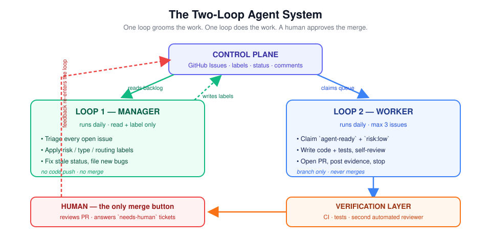
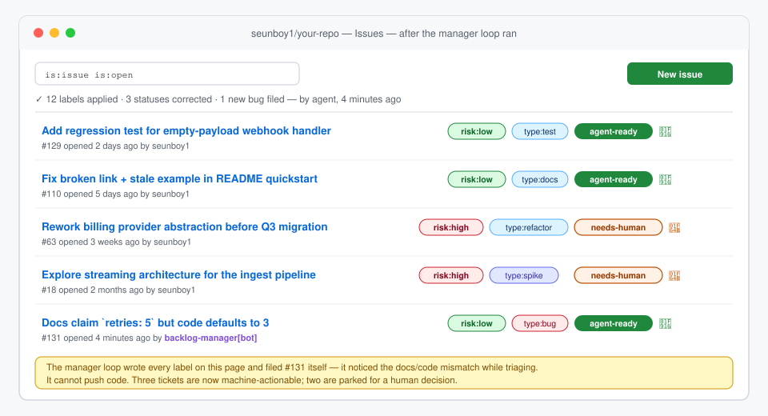
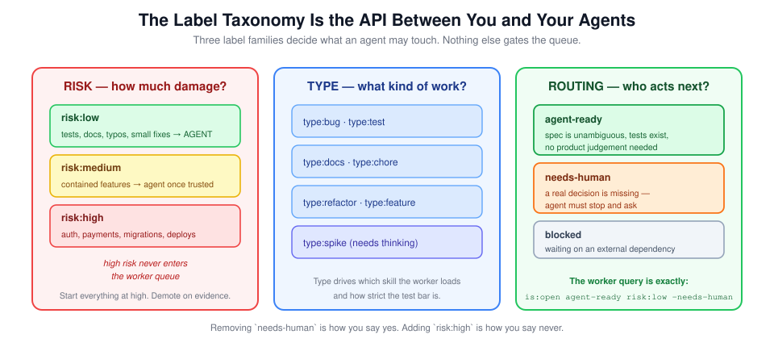
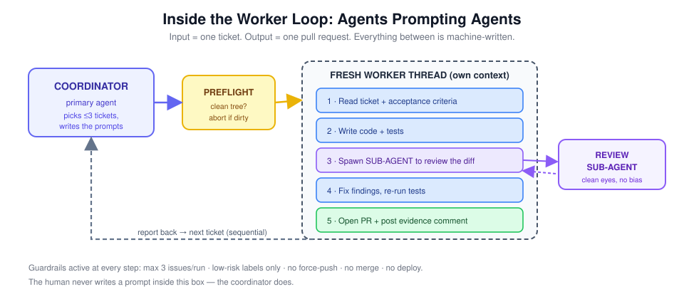
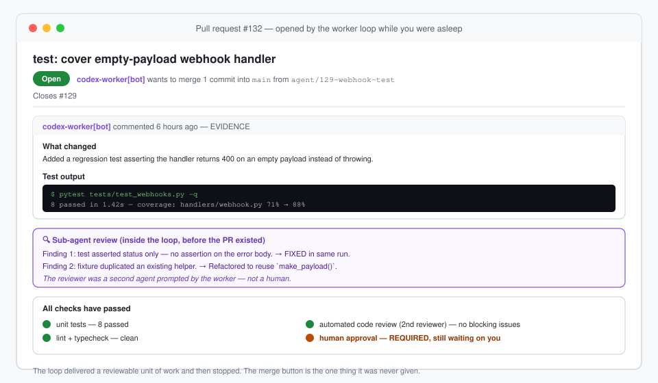
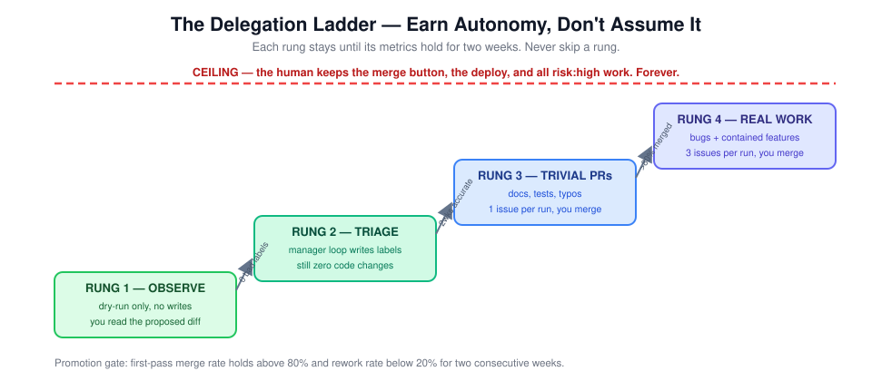

# Loop Engineering: How to Build AI Agents That Keep Working After You Close the Terminal

> A practical, illustrated handbook for turning Claude Code, Codex, or another coding agent into a guarded engineering system—not a one-shot chatbot.

<p align="center">
  
</p>

Most developers use coding agents like very fast pair programmers: type a prompt, wait for an answer, correct it, and repeat. That can be productive, but the human remains the scheduler, project manager, reviewer, and memory of the system.

**Loop engineering changes the unit of work.** Instead of writing one prompt that tells an agent what to do now, you design a repeatable system that decides what to do next, delegates bounded work, verifies the result, records evidence, and stops safely.

That distinction matters. A prompt produces an answer. A well-designed loop produces a controlled flow of reviewable work.

This handbook is based on the system-design ideas demonstrated in Owen's video, [“Agent Loops: Complete Guide (Claude Code + Codex)”](https://www.youtube.com/watch?v=RVEaDvh6f5A), then expanded into an implementation you can adapt to a real repository. The diagrams and mock interface panels in this repository are original illustrations—not screenshots from the video or GitHub.

---

## What loop engineering actually means

The phrase can sound more mysterious than it is. An agent loop has five moves:

1. **Wake** on a schedule or event.
2. **Read state** from a control plane such as GitHub Issues or Linear.
3. **Choose one bounded action** allowed by policy.
4. **Change the world** by updating a ticket or opening a pull request.
5. **Record evidence and stop**, ready to repeat later.

In pseudocode:

```python
while scheduled:
    state = control_plane.read()
    task = policy.choose_safe_task(state)

    if task is None:
        report("No eligible work")
        break

    result = agent.execute(task)
    evidence = verifier.check(result)
    control_plane.update(task, result, evidence)
```

The `while` statement is not the interesting part. The engineering is in `control_plane`, `policy`, `verifier`, and the stop conditions.

A useful loop can answer four questions before it runs:

| Question | Example answer |
|---|---|
| What is the input? | One open issue labeled `agent-ready` and `risk:low` |
| What is the output? | One pull request linked to that issue |
| What is the quality check? | Tests, lint, independent agent review, then human approval |
| What can it never do? | Merge, deploy, edit secrets, or work on `risk:high` |

If those answers are vague, the loop is not ready to be autonomous.

---

## The control plane: visible state beats agent memory

An autonomous agent needs a shared, inspectable view of the world. Do not hide the truth in a model's conversation history. Put it somewhere a human can inspect, edit, and override.

GitHub Issues works well because it already provides:

- durable tickets and acceptance criteria;
- labels that act like a small policy language;
- statuses and assignments;
- comments that form an audit log;
- links from issues to commits and pull requests;
- familiar permissions and notifications.

The control plane is not just a task list. It is the coordination boundary between humans and machines. An agent reads it before acting and writes its result back after acting. A human can interrupt the system by changing a label without editing any prompt.

<p align="center">
  
</p>

*Illustrative mock panel: the manager loop labels safe tickets, parks ambiguous work for a human, and can file a new issue when it discovers a mismatch.*

### Treat labels as an API

The simplest useful taxonomy has three independent dimensions:

<p align="center">
  
</p>

- **Risk** describes the blast radius: `risk:low`, `risk:medium`, `risk:high`.
- **Type** selects an appropriate process: `type:bug`, `type:test`, `type:docs`, `type:feature`, and so on.
- **Routing** says who acts next: `agent-ready`, `needs-human`, or `blocked`.

The worker's entire queue can then be expressed as a transparent GitHub query:

```text
is:issue is:open label:agent-ready label:risk:low -label:needs-human
```

This is deliberately boring. A reviewer should be able to understand why an agent selected a ticket without reading model traces.

---

## The two-loop architecture

A safe starting system separates **deciding what is suitable** from **doing the work**.

### Loop 1: the manager

The manager loop behaves like a meticulous engineering manager with narrow permissions. On a schedule—or whenever an issue is opened—it:

- reads the open backlog;
- checks whether each ticket has enough context;
- applies risk, type, and routing labels;
- corrects obviously stale status;
- reports ambiguities rather than inventing product decisions;
- optionally files tickets for bugs or documentation mismatches it discovers.

It can edit issues. It **cannot push code, merge, or deploy**.

The automation that starts this loop should remain small:

```yaml
- name: Triage backlog with Claude Code
  env:
    GH_TOKEN: ${{ secrets.GITHUB_TOKEN }}
  run: |
    claude -p \
      "Use .agents/skills/backlog-manager/SKILL.md to triage this repository. Apply labels and post a summary. Do not edit code."
```

The detailed process belongs in a versioned skill, not in a giant workflow prompt. This repository includes that skill at [`.agents/skills/backlog-manager/SKILL.md`](.agents/skills/backlog-manager/SKILL.md).

### Loop 2: the worker

The worker loop polls only the pre-classified safe queue. For each eligible ticket, it starts a fresh agent context and asks for one output: a reviewable pull request.

It follows an inner workflow:

1. verify that the repository is clean;
2. claim one ticket so another worker cannot duplicate it;
3. create a dedicated branch;
4. read the issue and inspect the relevant code;
5. implement the smallest complete change;
6. add or update tests;
7. run focused checks;
8. ask a second agent to review the diff;
9. fix valid findings and rerun checks;
10. open a pull request, attach evidence, and stop.

<p align="center">
  
</p>

This is “agents prompting agents” in concrete form. The human gives the coordinator a durable process. The coordinator writes a task-specific prompt for a fresh worker. The worker writes a diff-review prompt for another agent. Each context has a role, a budget, and a stop condition.

### Sequential first, parallel later

Parallel workers look impressive in diagrams, but they introduce real systems problems:

- two tasks may edit the same file;
- migrations or refactors may have an unstated order;
- workers can invalidate one another's assumptions;
- token and CI spend can spike simultaneously;
- failure diagnosis becomes harder.

Start sequentially. Move to isolated worktrees or disposable containers only after your ticket dependencies and ownership boundaries are reliable. Concurrency is a scaling optimization, not a prerequisite for autonomy.

---

## Verification is what turns automation into a system

An agent saying “done” is not evidence. A loop should leave behind enough information for a reviewer to understand what changed and reproduce the checks.

Every pull request should include:

- the issue it closes;
- a short explanation of the approach;
- the exact tests and commands run;
- test results and meaningful coverage changes;
- review findings from the independent sub-agent;
- risks, assumptions, or checks that could not be completed.

<p align="center">
  
</p>

*Illustrative mock panel: the worker supplies an evidence trail; CI and a second automated reviewer verify it; human approval remains required.*

The strongest pattern is layered verification:

1. **The worker checks its own work** by running tests and reading its diff.
2. **A fresh sub-agent reviews the diff** without sharing the worker's reasoning bias.
3. **Deterministic CI runs** tests, linting, type checks, security scans, or policy checks.
4. **An external automated reviewer** can add another independent signal.
5. **A human makes the irreversible decision** to merge or deploy.

Do not ask one model instance to be author, judge, and final approver. Independence matters.

---

## Guardrails: constrain capabilities, not just words

A line in a prompt that says “never deploy” is useful but insufficient. Real guardrails should exist at several layers.

### Selection guardrails

The worker must reject a ticket unless all required labels are present and prohibited labels are absent. It should not “use judgment” to override the queue.

```bash
QUERY='is:issue is:open label:agent-ready label:risk:low -label:needs-human -label:blocked'
gh issue list --search "$QUERY" --limit 3 --json number,title,url
```

### Quantity and budget guardrails

Cap work per run. Three tickets is a reasonable upper bound only after proving one-ticket runs are reliable.

```bash
MAX_ISSUES="${MAX_ISSUES:-1}"
MAX_ISSUES=$(( MAX_ISSUES > 3 ? 3 : MAX_ISSUES ))
```

Also cap wall-clock time, agent turns, token spend, and retry count. A broken ticket should not consume the entire day's budget.

### Environment guardrails

Abort on an unclean working tree. Use a dedicated branch or isolated worktree. Run in a disposable CI runner when possible.

```bash
if [[ -n "$(git status --porcelain)" ]]; then
  echo "Refusing to run: working tree is dirty" >&2
  exit 2
fi
```

### Permission guardrails

Give the manager `issues: write` and `contents: read`. Give the worker enough permission to push a branch and open a PR, but protect `main` so no bot can merge directly. Never expose production credentials to a coding loop.

```yaml
permissions:
  contents: write
  issues: write
  pull-requests: write
  # no deployments, packages, actions, or administration
```

Use branch protection and GitHub environments as independent enforcement, not conventions.

### Stop conditions

The agent must stop when:

- acceptance criteria are missing or contradictory;
- a required product or architecture decision is unstated;
- tests fail for an unrelated reason;
- the change touches secrets, authentication, payments, deployments, or destructive migrations;
- the diff grows beyond the ticket's clear scope;
- the same failure repeats beyond the retry limit.

A safe agent escalates uncertainty. It does not hide it.

---

## Hands-on tutorial: build your first loop

This repository contains a provider-neutral shell implementation. It supports either Claude Code or Codex through two small adapter functions in [`scripts/lib/agent.sh`](scripts/lib/agent.sh).

### 1. Prerequisites

Install and authenticate:

- Git;
- [GitHub CLI](https://cli.github.com/) (`gh auth login`);
- either Claude Code (`claude`) or Codex (`codex`);
- a repository where you can create labels, issues, branches, and pull requests.

Clone this handbook or copy its `.agents`, `scripts`, and `.github/workflows` directories into your project.

```bash
git clone git@github.com:seunboy1/loop-engineering-handbook.git
cd loop-engineering-handbook
cp .env.example .env
```

Choose your agent:

```dotenv
AGENT_PROVIDER=claude   # or codex
MAX_ISSUES=1
APPLY=false             # begin with dry-run triage
```

### 2. Install the label API

```bash
./scripts/setup-labels.sh
```

The script creates the risk, type, and routing labels idempotently. Running it again updates descriptions and colors rather than creating duplicates.

### 3. Run the manager in dry-run mode

```bash
./scripts/manager-loop.sh --dry-run
```

Read the proposed classification summary. Correct the skill if it repeatedly misunderstands your domain. Only then allow writes:

```bash
./scripts/manager-loop.sh --apply
```

The manager prompt is intentionally short because the process is encoded in the skill:

```bash
run_agent "Use the backlog-manager skill. Triage open issues in dry-run mode.
Do not edit repository files, push branches, or open pull requests."
```

### 4. Prepare one safe ticket

Create a small issue with explicit acceptance criteria—ideally a documentation correction or missing regression test. Apply:

```text
risk:low
agent-ready
type:docs   # or type:test / type:bug
```

Do not apply `needs-human` or `blocked`.

### 5. Preview the worker queue

```bash
./scripts/worker-loop.sh --dry-run
```

The preview prints the exact issue(s) the worker would claim. This lets you confirm that policy selection works before granting code-write capability.

### 6. Run one worker

```bash
MAX_ISSUES=1 ./scripts/worker-loop.sh --apply
```

The coordinator creates a task-specific prompt containing the issue body and the process in the implementation skill. The agent writes code on a branch, runs checks, performs an independent review, and opens a PR.

Do not schedule anything yet. Run manually until the same path succeeds several times.

### 7. Add scheduling only after trust is earned

The included GitHub Actions workflows default to safe limits and can also be run manually:

- [`.github/workflows/manager-loop.yml`](.github/workflows/manager-loop.yml)
- [`.github/workflows/worker-loop.yml`](.github/workflows/worker-loop.yml)

For GitHub-hosted runners, install the agent CLI and configure its non-interactive authentication according to your provider. Store credentials as repository or organization secrets—never in this repository.

---

## Encode process, not encyclopedic knowledge

A common mistake is writing enormous prompts that reteach the model software engineering. Modern coding agents already know how to inspect a project, write a unit test, and review a diff. Your skill should instead encode the process that is specific to your system:

- which queue is eligible;
- what evidence must be posted;
- what checks are mandatory;
- what risk requires escalation;
- who is allowed to merge;
- when the loop must stop.

Compare these two instructions:

> Write high-quality code using best practices and comprehensive tests.

That sounds sensible but is not operational. This is better:

> Work only on issue #129. Do not change public APIs. Run the test file that covers the modified module, then the repository's required check command. Ask a fresh reviewer agent to inspect `git diff main...HEAD`. Fix blocking findings once. Open a PR with the exact commands and outputs. Never merge.

The second prompt supplies boundaries, evidence, and termination—not a software-engineering lecture.

---

## Measure the loop like a production system

You cannot safely increase autonomy without evaluation. Track at least:

| Metric | Why it matters |
|---|---|
| **First-pass merge rate** | Percentage of agent PRs merged without requested code changes |
| **Rework rate** | Percentage returned to the agent or heavily rewritten by a human |
| **Issue reopen rate** | Detects superficially complete fixes |
| **Escalation precision** | Whether `needs-human` is used for real ambiguity, not routine work |
| **Mean cost per merged PR** | Tokens and CI spend divided by useful output |
| **Cycle time** | Time from `agent-ready` to reviewable PR |
| **Policy violation count** | Any attempt to touch prohibited scope; target is always zero |

A simple weekly scorecard is more valuable than anecdotes about impressive individual runs.

```text
first_pass_merge_rate = merged_without_changes / agent_prs_reviewed
rework_rate           = prs_requiring_changes / agent_prs_reviewed
cost_per_merged_pr     = total_agent_and_ci_cost / merged_agent_prs
```

Review failed runs, too. Your best improvements will usually come from tightening issue templates, narrowing skills, adding deterministic checks, or creating a better stop condition—not from adding more motivational language to prompts.

---

## Grow autonomy one rung at a time

<p align="center">
  
</p>

A sensible adoption path is:

1. **Observe:** the system only proposes classifications and changes.
2. **Triage:** the manager may write issue labels and comments, but no code.
3. **Trivial PRs:** the worker may open one docs or test PR per run.
4. **Contained work:** the worker may handle low-risk bugs and small features, capped at three.

Promotion should depend on evidence. For example: advance only after first-pass merge rate stays above 80%, rework remains below 20%, and policy violations remain at zero for two consecutive weeks.

Some authority should never be delegated merely because the success rate improved. Keep high-risk product choices, secrets, production deployment, destructive data changes, and final merge approval behind a human boundary.

---

## Failure modes to design out

### “The agent can choose any issue”

This turns a backlog into an unbounded prompt. Fix it with explicit risk and routing labels plus a deterministic query.

### “The agent reviewed its own code”

Self-review is useful but correlated with the original mistake. Add a fresh sub-agent and deterministic CI.

### “It ran all night and spent a fortune”

Cap issues, time, turns, retries, and cost. Make absence of work a successful outcome.

### “Two agents changed the same module”

Run sequentially first. Later, add worktrees, file ownership, dependency detection, and a coordinator that understands conflicts.

### “No one knows what the agent actually tested”

Require exact commands and results in the issue or PR. Make missing evidence a CI failure.

### “The prompt says not to merge”

Prompts are not permissions. Enforce branch protection so the automation identity literally cannot merge.

### “The ticket needed a product decision, so the model made one”

Define ambiguity as a stop condition and route the issue to `needs-human` with a concise question.

---

## The deeper shift: think in systems

The most important change is not technical. It is the level of abstraction at which you work.

When you prompt a coding agent, you ask: **What should it do?**

When you design a loop, you ask:

- What state does it observe?
- Which decisions are deterministic and which require judgment?
- What capabilities should this role receive?
- How is work claimed and made idempotent?
- What evidence proves success?
- Who can reverse or approve the result?
- What happens when a dependency fails?
- How do we know the system is improving?

That is ordinary systems design applied to capable agents.

The goal is not to remove humans from software engineering. It is to remove humans from repetitive orchestration while preserving human judgment at the boundaries that matter. A good loop does not hide autonomous work. It makes the work more visible, more reviewable, and easier to stop than an improvised terminal session.

Start with one low-risk issue. Keep the merge button. Measure what happens. Then earn the next rung.

---

## Repository map

```text
.
├── README.md                              # the article and tutorial
├── .agents/skills/
│   ├── backlog-manager/SKILL.md           # triage process
│   └── issue-worker/SKILL.md              # ticket-to-PR process
├── .github/
│   ├── ISSUE_TEMPLATE/agent-task.yml      # agent-ready issue structure
│   └── workflows/
│       ├── manager-loop.yml               # scheduled/manual triage
│       └── worker-loop.yml                # scheduled/manual execution
├── docs/images/                           # original SVG figures and mock panels
├── prompts/                               # provider-neutral coordinator prompts
└── scripts/
    ├── lib/agent.sh                       # Claude/Codex adapter
    ├── setup-labels.sh                    # install label taxonomy
    ├── manager-loop.sh                    # run triage
    └── worker-loop.sh                     # guarded worker coordinator
```

## Responsible-use notice

This project is an educational blueprint. Agent CLIs and their non-interactive flags change over time; review the adapter before using it. Run dry first. Use least-privilege tokens, protected branches, spend limits, isolated runners, and human approval. Never give an unattended coding loop production credentials.

## License

MIT — see [`LICENSE`](LICENSE).
