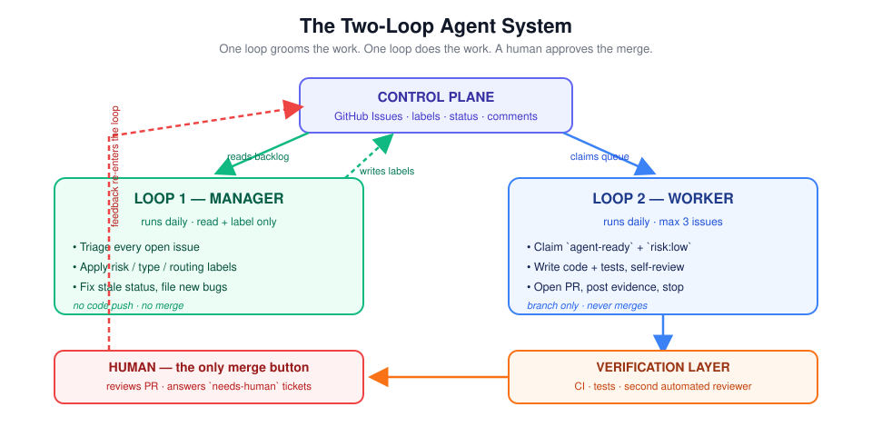
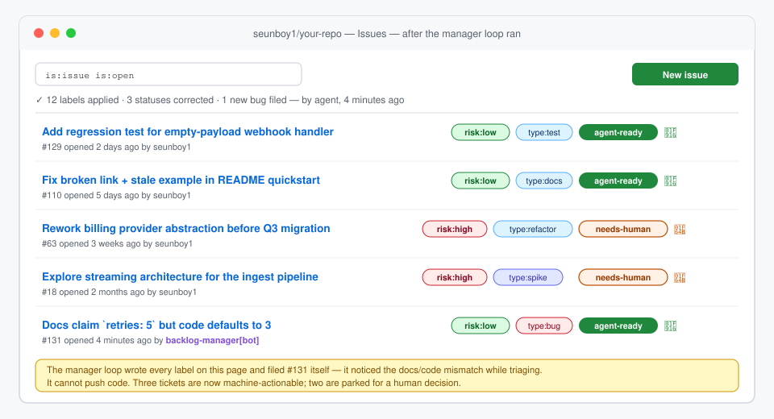
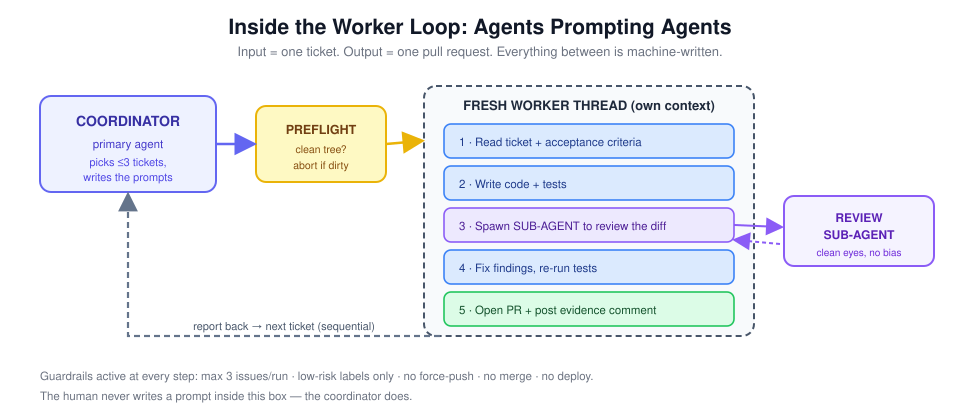
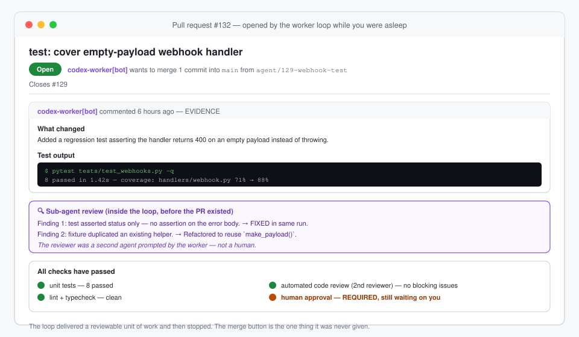

# Stop Prompting Agents. Start Designing Loops.

## A practical guide to building autonomous coding systems with Claude Code, Codex, GitHub Issues, guardrails, and human review

Most developers still use coding agents like a faster search box.

We open a terminal, describe a task, wait for the model to write code, correct it, and repeat. The agent may be fast, but the human remains responsible for remembering the backlog, selecting the next task, supplying context, checking the work, and deciding what happens afterward.

That workflow is useful. It is not autonomous.

The more interesting shift is from **prompting an agent** to **designing a system that prompts agents**. This is often called loop engineering. The name can sound abstract, but the idea is straightforward: an agent wakes up, reads visible state, chooses a bounded task, performs allowed work, records evidence, and stops. Later, the process repeats.

The loop is easy. Designing the boundaries around it is the real engineering.



*One loop prepares the work. Another executes it. The control plane and verification layer keep both visible.*

## A prompt gives you an answer. A loop gives you a workflow.

A conventional coding prompt might say:

> Add a test for the webhook handler and open a pull request.

A loop starts one level higher. It asks:

1. Where do tasks come from?
2. How does the system decide which tasks are safe?
3. Which permissions does each agent receive?
4. How is duplicate work prevented?
5. What proves that the result is correct?
6. When must the agent stop and ask for help?
7. Who is allowed to make the irreversible decision?

A useful mental model is:

```python
while scheduled:
    state = control_plane.read()
    task = policy.choose_safe_task(state)

    if task is None:
        report("No eligible work")
        break

    result = agent.execute(task)
    evidence = verifier.check(result)
    control_plane.update(task, result, evidence)
```

The `while` statement is not the important part. The system lives inside `control_plane`, `policy`, and `verifier`.

Before a loop runs unattended, it should have four explicit answers:

| Design question | Example answer |
|---|---|
| What is the input? | One open issue labeled `agent-ready` and `risk:low` |
| What is the output? | One pull request linked to that issue |
| What is the quality check? | Tests, a fresh agent review, CI, and human approval |
| What can it never do? | Merge, deploy, read production secrets, or select high-risk work |

If any answer is vague, the loop is not ready.

## Give agents a visible control plane

Autonomous work should not depend on a model remembering an earlier conversation. State belongs somewhere durable, inspectable, and editable by humans.

GitHub Issues is a surprisingly effective control plane because it already has:

* durable tickets and acceptance criteria;
* labels and status;
* comments that form an audit trail;
* links to branches, commits, and pull requests;
* familiar identity and permission controls.

The control plane acts as the boundary between humans and machines. Agents read from it before acting and write evidence back afterward. A human can stop or reroute work by changing a label, without hunting for a hidden prompt or conversation thread.



*An illustrative issue queue after a manager loop has classified the backlog.*

### Labels become a small policy language

A practical taxonomy needs three independent dimensions.

**Risk** describes the possible blast radius:

* `risk:low` for documentation, tests, and narrowly scoped fixes;
* `risk:medium` for contained features or refactors;
* `risk:high` for authentication, payments, migrations, deployment, public API changes, or unclear scope.

**Type** describes the work:

* `type:bug`
* `type:docs`
* `type:test`
* `type:refactor`
* `type:feature`
* `type:spike`

**Routing** says who acts next:

* `agent-ready`
* `needs-human`
* `blocked`

The worker queue then becomes a deterministic query rather than a vague instruction:

```bash
QUERY='is:issue is:open label:agent-ready label:risk:low \
  -label:needs-human -label:blocked -label:agent-running'

gh issue list \
  --search "$QUERY" \
  --limit 1 \
  --json number,title,body,url,labels
```

Anyone can see why a ticket was selected. The agent is not quietly redefining “safe” for itself.

## Separate management from execution

A strong starting architecture uses two loops with different permissions.

### The manager loop

The manager behaves like a meticulous engineering manager. It reads open issues, checks whether each one has enough context, applies labels, corrects stale status, and asks concise questions when a ticket is ambiguous.

Its job is to keep the backlog ready for humans and machines.

Its permissions should be narrow:

```yaml
permissions:
  contents: read
  issues: write
```

The manager can update tickets. It cannot push code, open a code change, merge, or deploy.

The automation prompt can remain short because the process belongs in a versioned skill:

```bash
claude --print \
  "Use the backlog manager skill to triage this repository. \
  Apply labels and post a summary. Do not edit code."
```

The skill should define the risk rubric, the criteria for `agent-ready`, the conditions that require human input, and the evidence required in the final report.

This is a useful design principle: **encode process, not encyclopedic knowledge**. A capable model already knows what a unit test is. It needs your rules for which queue it may touch and when it must stop.

### The worker loop

The worker reads only tickets that have already passed the policy gate. It verifies the labels again, claims one issue, creates a branch, writes the smallest complete change, adds tests, and opens a pull request.

A safe inner workflow looks like this:

1. Verify that the repository is clean.
2. Claim one eligible issue.
3. Create a dedicated branch.
4. Read the issue and relevant repository guidance.
5. Implement the smallest complete change.
6. Add or update tests.
7. Run focused checks.
8. Ask a fresh agent to review the diff.
9. Fix valid findings and rerun checks.
10. Open a pull request with evidence and stop.



*The coordinator writes the worker prompt. The worker writes a review prompt for a fresh sub-agent.*

This is where “agents prompting agents” becomes concrete. The human does not need to write a custom prompt for every ticket. The coordinator reads the ticket and creates the task-specific instruction. The worker then creates a separate review instruction for another agent.

Each context has one role and one output.

## Verification is the heart of autonomy

An agent saying “done” is not proof.

Every autonomous run should leave an evidence trail that a reviewer can reproduce. A pull request should include:

* the issue it closes;
* a concise explanation of the approach;
* the exact test commands that ran;
* the outcome of those commands;
* meaningful coverage changes when available;
* findings from an independent reviewer agent;
* risks, assumptions, and checks that could not run.

A useful verification stack has several layers:

1. The worker reads its own diff and runs tests.
2. A fresh agent reviews the diff without sharing the worker's rationale.
3. Deterministic CI runs tests, linting, type checks, and policy checks.
4. An optional external code-review service adds another signal.
5. A human decides whether to merge.

The fresh reviewer matters because author and reviewer mistakes are correlated when they share the same context. The second agent should receive the issue criteria and the diff, not the first agent's argument for why its solution is correct.



*The worker delivers a reviewable artifact, not a claim of completion.*

## Guardrails must exist outside the prompt

“Never deploy” is a useful instruction. It is not a security control.

Good systems constrain capabilities at several layers.

### Selection controls

The worker must reject any issue that lacks required labels or carries a prohibited label. It should not override the query with its own judgment.

### Quantity controls

Start with one issue per run. Cap the maximum even after increasing it.

```bash
MAX_ISSUES="${MAX_ISSUES:-1}"
(( MAX_ISSUES > 3 )) && MAX_ISSUES=3
```

Also cap time, turns, retry attempts, and spending. “No eligible work” should be a successful outcome.

### Environment controls

Abort when the working tree is dirty:

```bash
if [[ -n "$(git status --porcelain)" ]]; then
  echo "Refusing to run: working tree is dirty" >&2
  exit 2
fi
```

Use an isolated worktree or disposable CI runner. Do not place an autonomous coding agent on a machine that can reach production systems.

### Permission controls

Use least-privilege tokens. Protect the default branch. Do not give the automation identity the ability to merge, administer the repository, read production secrets, or deploy.

A branch-protection rule is stronger than a sentence in a prompt because it remains true even when the model makes a mistake.

### Stop conditions

A safe worker stops when:

* acceptance criteria conflict;
* a product or architecture decision is missing;
* unrelated tests fail;
* the change touches authentication, billing, secrets, production operations, or destructive migrations;
* the diff expands materially beyond the issue;
* the same failure repeats beyond the retry limit.

Escalating uncertainty is successful behavior. Hiding uncertainty is a system failure.

## Start sequentially

It is tempting to assign ten tickets to ten agents at once. Parallelism is impressive until two agents edit the same module, one migration invalidates another task, or several CI runs consume the budget simultaneously.

Start with one worker and one ticket.

Move to parallel workers only after adding isolated worktrees or containers, explicit ownership boundaries, dependency detection, and a coordinator that understands conflicts. Concurrency is a scaling optimization, not a requirement for autonomy.

## Measure before increasing trust

You cannot improve a loop safely without evaluation. Track at least:

| Metric | What it reveals |
|---|---|
| First-pass merge rate | How often an agent PR merges without requested changes |
| Rework rate | How often a human or agent must substantially redo the work |
| Issue reopen rate | Whether fixes were superficial |
| Escalation precision | Whether the agent asks for help at the right time |
| Cost per merged PR | Whether the workflow is economically useful |
| Cycle time | How long safe work takes to become reviewable |
| Policy violations | Whether an agent attempted prohibited work |

A weekly scorecard is more useful than a story about one impressive pull request.

Increase scope only after the metrics hold for a meaningful period. A practical progression is:

1. Dry-run proposals only.
2. Issue triage and labels, with no code changes.
3. One documentation or test pull request per run.
4. Low-risk bug fixes and contained features, still requiring human approval.

The merge button, deployment authority, high-risk work, secrets, and destructive data operations can remain human responsibilities permanently.

## Build one small loop this week

You do not need a complicated multi-agent platform to begin.

Choose one repository. Create a clear issue template. Add risk and routing labels. Write a manager skill that classifies tickets without touching code. Run it in dry mode. Review the output. Then allow it to update labels.

Next, choose one missing test or documentation correction. Give a worker access to that single ticket. Require a branch, tests, a fresh review, and a pull request. Keep the merge decision for yourself.

That small experiment will teach you more than a hundred abstract discussions about autonomous agents.

The deeper shift is not from humans to machines. It is from improvised prompting to explicit systems. Humans continue to supply judgment. Agents take over repetitive coordination and bounded execution. The control plane makes the work visible. The verification layer makes it reviewable. Permissions keep mistakes contained.

A prompt asks an agent to complete a task.

A loop creates a reliable path from safe task to reviewed result.

That is the difference.

---

## Get the complete implementation

The open-source [Loop Engineering Handbook](https://github.com/seunboy1/loop-engineering-handbook) contains:

* a 3,000-word illustrated guide;
* manager and worker loop scripts;
* Claude Code and Codex adapters;
* versioned agent skills and prompts;
* GitHub Actions workflows;
* issue and pull-request templates;
* six original architecture and interface diagrams;
* security guidance and verification scripts.

Start in dry-run mode. Keep the merge button. Earn each additional level of autonomy with evidence.
